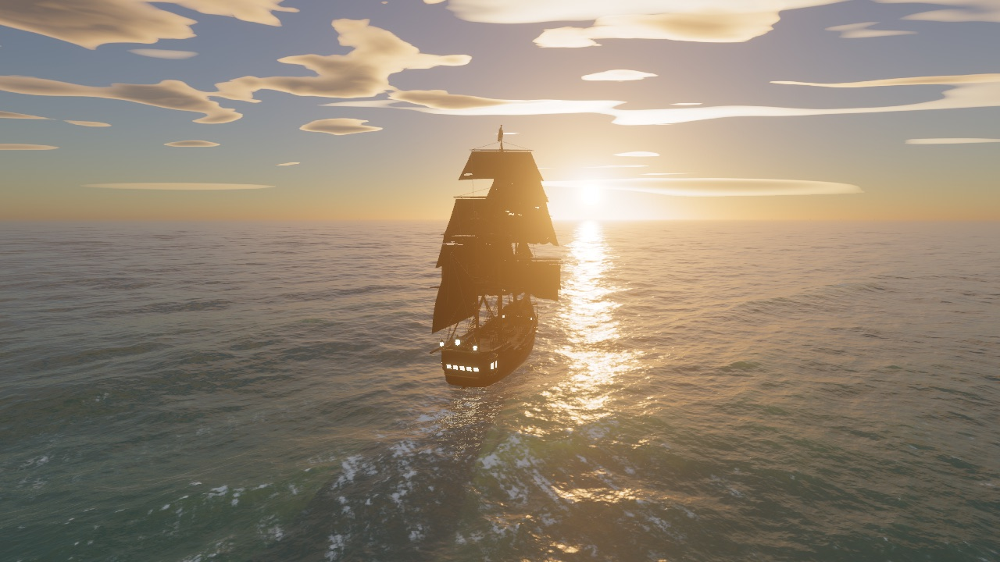
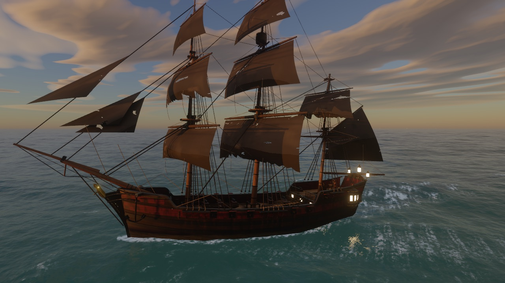
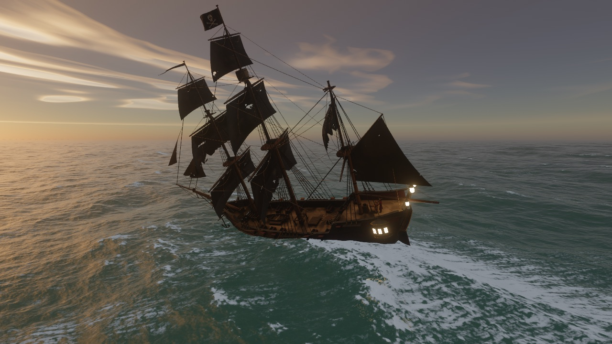
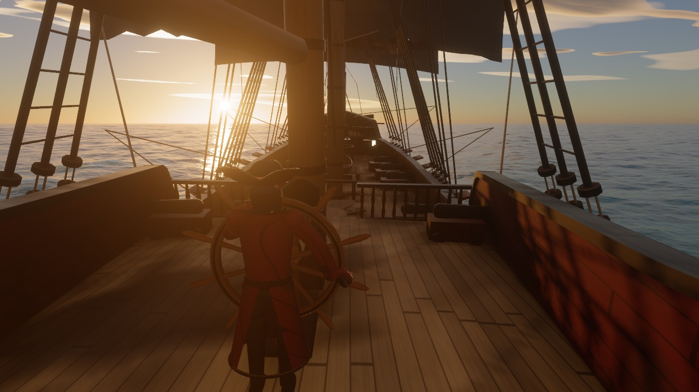
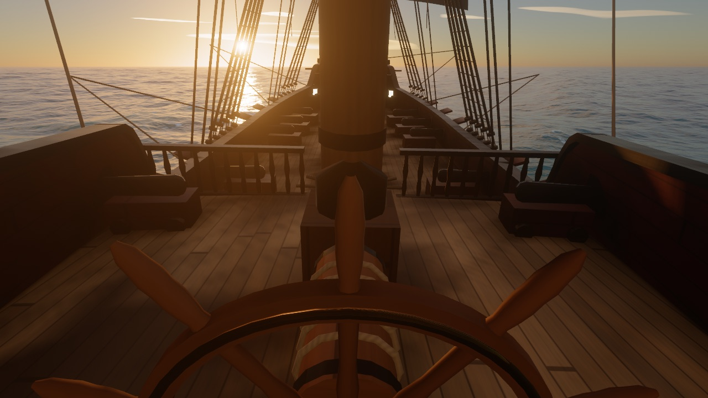
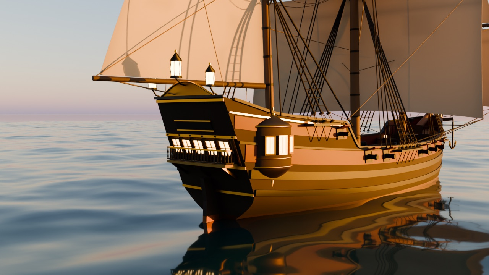
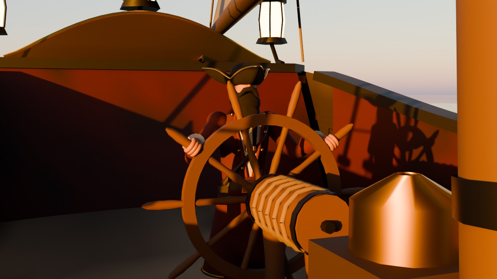

# web-ocean — pirate ship fork

This fork of [Noniv/web-ocean](https://github.com/Noniv/web-ocean) puts a sailable pirate ship on the sunset sea. The ship is a three-masted ship built procedurally in Blender. It has black, torn sails, and a bearded helmsman stands at the wheel. It rides the simulated FFT waves, leaves a wake, and a sea shanty plays while you sail.



| Evening sea | Storm (G) |
|---|---|
|  |  |
| **Behind the helmsman (V)** | **Through his eyes (V)** |
|  |  |

## Sailing

| Input | Action |
|---|---|
| W / S | Set more or less sail (the sails gather up at the yards) |
| A / D | Helm to port / starboard (the wheel turns, the helmsman's hands follow it) |
| V | View: chase camera, behind the helmsman, through his eyes |
| Mouse (click to capture, or right-drag) | Orbit the camera around the ship, or look around in the helm views |
| Mouse wheel | Camera distance |
| G | Storm on/off (blends in over 8 s: wind, swell, clouds) |
| M | Music on/off (starts with the first key press or click) |
| F | Switch between the ship cameras and the original free camera |
| H | Settings panel |

Speed depends on the sail setting and on the angle to the wind (`windDir`). The start course is toward the sun with the wind on the starboard quarter. The sails fill and swell in gusts. They luff and shake when the wind comes from ahead. Wind pressure and turns make the ship heel.

**Performance:** the render resolution adapts to keep about 60 fps. It starts at 1.5× CSS pixels on Retina screens. `?scale=1` fixes the scale at full native resolution.

**URL parameters for testing:**
- `ship=x,z,headingDeg`, `sail=0..1`, `helm=-1..1` (holds the rudder)
- `orbit=yawDeg,pitchDeg,dist`: yaw is relative to the heading
- `view=0|1|2`, `storm=1`, `music=0`, `debug=1` (exposes `window.ship`)
- `shipmesh=assets/ship_test.bin`

`tools/shot.sh name.png "params"` renders one frame in headless Chrome into `shots/` (run `npm start` first).

## How the ship works

- **Model:** `blender/build_ship.py` builds the whole ship from code. It makes:
  - the lofted hull, gunports and cannons, and the stern gallery with lanterns
  - three masts, 12 black sails with repair patches and torn feet, shrouds and ratlines, and a Jolly Roger
  - the wheel and the helmsman (tricorn, braided beard, eye patch, red coat)
  - weathering in the vertex colours (grime streaks, algae at the waterline, salt crust) and AO from ray casts

  It exports `assets/ship.bin` (168k triangles, 5.3 MB). Rebuild it with `blender -b --factory-startup --python blender/build_ship.py`, and add `-- --render final --views front34,sternq --samples 160` for Cycles previews. `blender/verify_bin.py` checks the file.

  | Blender preview | | |
  |---|---|---|
  |  |  |  |

- **Mesh format:** a 64-byte header (includes the helmsman's eye position), then 28-byte vertices, then u32 indices. Each vertex has a position, a normal, a UV in metres, albedo + baked AO, and material id / roughness / extra / tag. Tags mark the turning wheel and the helmsman. For the helmsman, "extra" is how much a vertex follows the wheel, which acts as a simple arm skin. `js/ship.js` documents the format.
- **Buoyancy:** a compute shader reads the displaced sea height at 10 points on the waterplane. It inverts the choppy horizontal displacement. The CPU fits a plane to the heights. Damped oscillators then drive heave, pitch, and roll. Roll is lightly damped with a period near the swell's (about 7 s), and the wave forcing grows with swell height. So a calm evening rolls the ship about ±7°, and the storm rolls it about ±20°.
- **Animation (vertex shader):**
  - Sails swell, ripple, and luff with the wind fill and gusts. They gather up when you shorten sail.
  - The flag streams.
  - The wheel turns about its axle with the rudder.
  - The helmsman's arms follow the wheel up to about 50°, and his body stays upright against the roll.
- **Shading:**
  - Sun with a 2048² shadow map (PCF), sky light from the environment cube, GGX specular, and translucent canvas.
  - Procedural round holes in the sails. They also let sunlight through in the shadow map.
  - Rain streaks, procedural planks and caulking.
  - Flickering lantern lights, and the same aerial perspective as the sea.
- **Ship and sea:**
  - The shadow map darkens the sea, so the hull blocks the sun glitter.
  - A mirrored half-resolution render of the ship goes into the water reflection.
  - The foam update injects a hull band, a bow wave, the two 19.5° Kelvin arms, and a torn stern wake into the world-space foam maps.
- **Music:** `assets/shanty.mp3` is an original sea shanty in the style of "What Shall We Do with the Drunken Sailor". It was made with the ElevenLabs music API.

The bundled `ocean.html` / `ocean.min.html` embed the ship mesh and the music as base64, so they are about 10 MB each and still work from `file://`.

---

# web-ocean (original README)

A real-time ocean renderer written from scratch on WebGPU, with no engine or rendering library. It draws a sunset sea with simulated waves, whitecaps, sun glitter, and a physically based sky with clouds. You fly around it with a free camera.


| 75 degrees off the sun, 2.4 m up | Looking toward the sun from 30 m up |
|---|---|
|  |  |

## Run it

You need a recent Chrome with WebGPU and a reasonably capable GPU. On a laptop, force Chrome onto the dedicated GPU in the Windows graphics settings, or it will fall back to the integrated one.

Open `ocean.html` directly in the browser. `ocean.min.html` is the same page minified (61 KB instead of 102 KB). Both are self-contained and work from `file://`.

To run from source:

```
npm install
npm start        # serves http://localhost:8080/
```

After editing anything under `js/`, run `npm run build` to regenerate both bundles. The minified build strips WGSL comments and whitespace and minifies the JavaScript with esbuild.

## Controls

| Input | Action |
|---|---|
| Click the canvas | Capture the mouse (Esc releases it). Holding the right mouse button also works. |
| Mouse | Look around |
| W A S D | Move |
| Space or E / Q or C | Up / down |
| Shift | 5x speed |
| Mouse wheel | Change base speed |
| H | Settings panel: wind, swell, choppiness, turbidity, foam, sun, haze, clouds, exposure, bloom |

The camera keeps itself above the displaced water surface, so waves never pass through it.

URL parameters are handy for testing. `?w=2560&h=1440` forces the render resolution, `cam=x,y,z,yawDeg,pitchDeg` sets the camera, `fov=deg` sets the field of view, `ui=0` hides the HUD, and any settings key works too, for example `windSpeed=12&swellHs=2&sunElev=8`.

## How it works

### Waves

The sea is a Tessendorf FFT simulation with six cascades of 256 by 256 samples. The patches range from 1103 m down to 0.26 m, so wavelengths run from about a kilometre to a few millimetres. The smallest cascade produces the sharp sun sparkles near the camera.

The spectrum is a fetch-limited JONSWAP wind sea with Donelan-Banner directional spreading, plus a narrow long-crested swell. Dispersion includes the capillary term, and choppy horizontal displacement sharpens the crests. The inverse FFTs are radix-2 compute shaders working in workgroup memory.

The surface mesh is a CDLOD quadtree with 17 levels. Vertices are 6.25 cm apart near the camera and the mesh reaches 160 km, with continuous vertex morphing between levels.

### Shading

- Mip-mapped first and second moments of the wave slopes (LEAN mapping) give the right anisotropic roughness at every distance. The sun glitter widens with distance and the far sea settles into a sheen without aliasing. Screen-space slope derivatives add specular anti-aliasing.
- Sun glitter uses an anisotropic Gaussian slope distribution with Smith masking and the size of the solar disc.
- The sky reflection comes from an environment cube map rebuilt every frame, with roughness-filtered mips. At grazing angles the reflection direction is tilted to account for which wave facets the viewer can actually see.
- The water body is turbid blue-green, lit by the whole sky hemisphere. Backlit crests get a subsurface glow, and wind-gust patches modulate the short ripples.
- Whitecaps start where the total surface Jacobian folds. Foam is stored in two camera-centred world-space maps (128 m and 1 km wide), decays over time, drifts downwind, and breaks into streaks as it ages. A procedural bubble texture gives it its structure.

### Sky

The atmosphere follows Hillaire's approach, with transmittance, multiple-scattering, and sky-view lookup tables plus aerosol haze. There are two cloud layers, a broken low cumulus and a fibrous altostratus deck. Each is shaded with self-shadowing toward the sun, lit rims, silver linings when backlit, and direction-dependent multiple scattering.

Cloud noise octaves are filtered by pixel footprint, and silhouettes are anti-aliased analytically: the screen-space derivative of each layer's edge function sets the width of its opacity edge. Cloud transmittance along the sun direction dims the sunlight that reaches the water, and aerial perspective is applied over the sea.

### Post-processing

The scene renders in HDR with 4x MSAA. Post-processing adds an 8-level bloom, AgX tone mapping, a slight white balance shift, and dithering.

## Performance

At 2560 by 1440 on an RTX 5070 Ti, the GPU takes about 6 to 8 ms per frame, measured while other programs were also using the GPU. The HUD shows FPS and GPU time when the browser supports `timestamp-query`.

The per-frame code reuses preallocated typed arrays and descriptors, so the garbage collector has almost nothing to do. The only recurring allocations are the objects WebGPU itself requires, such as the swap-chain view and command buffers.

## Known limitations

- Far water is still somewhat darker than the bright horizon sky above it.
- The water is tuned toward turbid coastal water. The "Water turbidity" slider gives darker, bluer deep water when turned down.
- No shoreline or surf. The ship is the only object in the water.
- Clouds are two flat layers, not volumetric.

## How it was made

I built this with Claude Code (Opus 5.5). I asked for the most realistic water it could produce, in WebGPU, with a floating camera, and left the architecture and implementation to it. It checked its own work by rendering screenshots in headless Chrome and having separate critic subagents review them, so it was not grading its own output. I gave feedback along the way, mainly on the clouds, which led to replacing the volumetric clouds with the flat layers and later fixing their edge aliasing.

## Repository layout

| Path | Contents |
|---|---|
| `index.html` | Page shell, HUD, and settings panel styles |
| `js/main.js` | Device setup, resources, camera, per-frame loop |
| `js/ship.js` | Ship mesh loading, buoyancy, sailing controls, shadow / reflection / probe passes |
| `blender/` | Procedural Blender build of the ship and the mesh verifier |
| `assets/` | `ship.bin` (the ship), `ship_test.bin` (a crude stand-in), `shanty.mp3` (music) |
| `js/wgsl/` | Shaders as JavaScript modules: `sim.js` (waves and foam), `sky.js` (atmosphere and clouds), `ocean.js` (surface and sky pass), `post.js` (bloom and tone mapping), `ship.js` (ship shading, shadow, buoyancy probe), `common.js` (shared structs) |
| `server.mjs` | Tiny static server for development |
| `build.mjs` | Builds `ocean.html` and `ocean.min.html` |
| `docs/` | README images |

## License

MIT. See [LICENSE](LICENSE).
