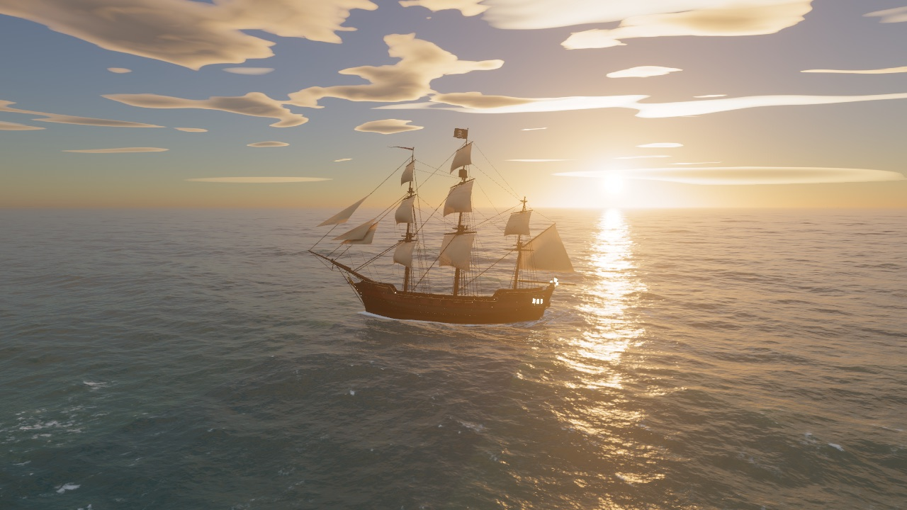
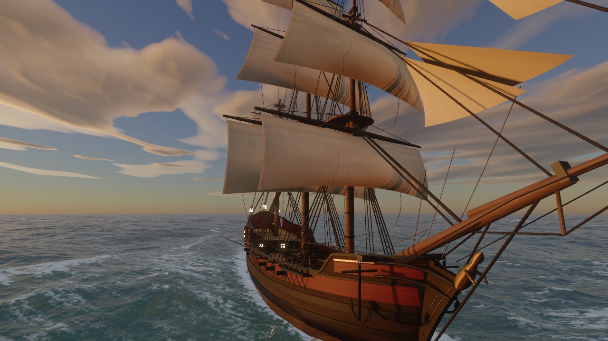

# web-ocean — pirate ship fork

This fork of [Noniv/web-ocean](https://github.com/Noniv/web-ocean) puts a sailable pirate ship on the sunset sea. The ship is a three-masted ship built procedurally in Blender. It rides the simulated FFT waves and leaves a wake. You steer it with the keyboard.


| On the sun path | Bow, rough sea |
|---|---|
|  |  |

## Sailing

| Input | Action |
|---|---|
| W / S | Set more or less sail (the sails gather up at the yards) |
| A / D | Helm to port / starboard |
| Mouse (click to capture, or right-drag) | Orbit the camera around the ship |
| Mouse wheel | Camera distance |
| F | Switch between the chase camera and the original free camera |
| H | Settings panel |

Speed depends on the sail setting and on the angle to the wind (`windDir`). The ship is fastest with the wind on the quarter and slowest heading into it. Wind pressure and turns make the ship heel.

URL parameters for testing: `ship=x,z,headingDeg`, `sail=0..1`, `orbit=yawDeg,pitchDeg,dist` (yaw is relative to the heading), `shipmesh=assets/ship_test.bin`. `tools/shot.sh name.png "params"` renders one frame in headless Chrome into `shots/` (run `npm start` first).

## How the ship works

- **Model:** `blender/build_ship.py` builds the whole ship from code: lofted hull, gunports and cannons, stern gallery with lanterns, three masts, 12 billowed sails, shrouds and ratlines, a Jolly Roger, and AO from ray casts. It exports `assets/ship.bin` (137k triangles, 4.4 MB). Rebuild it with `blender -b --factory-startup --python blender/build_ship.py`, and add `-- --render final --views front34,sternq --samples 160` for Cycles previews. `blender/verify_bin.py` checks the file.

  | Blender preview | |
  |---|---|
  |  |  |

- **Mesh format:** a 64-byte header, then 28-byte vertices (position, normal, UV in metres, albedo + baked AO, material id / roughness / flutter weight), then u32 indices. `js/ship.js` documents it.
- **Buoyancy:** a compute shader reads the displaced sea height at 10 points on the waterplane. It inverts the choppy horizontal displacement the same way as the camera probe. The CPU fits a plane to the heights. Damped springs then drive heave, pitch, and roll, each with its own natural period.
- **Shading:** sun with a 2048² shadow map (PCF), sky light from the environment cube, GGX specular, translucent canvas when backlit, flickering lantern point lights, and the same aerial perspective as the sea. Procedural planks, caulking, butt joints, and canvas cloths add detail on top of the vertex colours. Sails breathe and the flag waves in the vertex shader.
- **Ship and sea:** the shadow map also darkens the sea, so the hull blocks the sun glitter. A mirrored half-resolution render of the ship goes into the water reflection, distorted by the wave slopes. Tall parts fade out, because a rough sea scatters their reflection. The foam update injects a hull band, a bow wave, the two 19.5° Kelvin arms, and a torn stern wake into the world-space foam maps. That foam then decays and drifts like the whitecaps.

The bundled `ocean.html` / `ocean.min.html` embed the ship mesh as base64, so they are now about 5.8 MB each and still work from `file://`.

---

# web-ocean (original README)

A real-time ocean renderer written from scratch on WebGPU, with no engine or rendering library. It draws a sunset sea with simulated waves, whitecaps, sun glitter, and a physically based sky with clouds. You fly around it with a free camera.


| 75 degrees off the sun, 2.4 m up | Looking toward the sun from 30 m up |
|---|---|
|  |  |

## Run it

You need a recent Chrome with WebGPU and a reasonably capable GPU. On a laptop, force Chrome onto the dedicated GPU in the Windows graphics settings, or it will fall back to the integrated one.

Open `ocean.html` directly in the browser. `ocean.min.html` is the same page minified (61 KB instead of 102 KB). Both are self-contained and work from `file://`.

To run from source:

```
npm install
npm start        # serves http://localhost:8080/
```

After editing anything under `js/`, run `npm run build` to regenerate both bundles. The minified build strips WGSL comments and whitespace and minifies the JavaScript with esbuild.

## Controls

| Input | Action |
|---|---|
| Click the canvas | Capture the mouse (Esc releases it). Holding the right mouse button also works. |
| Mouse | Look around |
| W A S D | Move |
| Space or E / Q or C | Up / down |
| Shift | 5x speed |
| Mouse wheel | Change base speed |
| H | Settings panel: wind, swell, choppiness, turbidity, foam, sun, haze, clouds, exposure, bloom |

The camera keeps itself above the displaced water surface, so waves never pass through it.

URL parameters are handy for testing. `?w=2560&h=1440` forces the render resolution, `cam=x,y,z,yawDeg,pitchDeg` sets the camera, `fov=deg` sets the field of view, `ui=0` hides the HUD, and any settings key works too, for example `windSpeed=12&swellHs=2&sunElev=8`.

## How it works

### Waves

The sea is a Tessendorf FFT simulation with six cascades of 256 by 256 samples. The patches range from 1103 m down to 0.26 m, so wavelengths run from about a kilometre to a few millimetres. The smallest cascade produces the sharp sun sparkles near the camera.

The spectrum is a fetch-limited JONSWAP wind sea with Donelan-Banner directional spreading, plus a narrow long-crested swell. Dispersion includes the capillary term, and choppy horizontal displacement sharpens the crests. The inverse FFTs are radix-2 compute shaders working in workgroup memory.

The surface mesh is a CDLOD quadtree with 17 levels. Vertices are 6.25 cm apart near the camera and the mesh reaches 160 km, with continuous vertex morphing between levels.

### Shading

- Mip-mapped first and second moments of the wave slopes (LEAN mapping) give the right anisotropic roughness at every distance. The sun glitter widens with distance and the far sea settles into a sheen without aliasing. Screen-space slope derivatives add specular anti-aliasing.
- Sun glitter uses an anisotropic Gaussian slope distribution with Smith masking and the size of the solar disc.
- The sky reflection comes from an environment cube map rebuilt every frame, with roughness-filtered mips. At grazing angles the reflection direction is tilted to account for which wave facets the viewer can actually see.
- The water body is turbid blue-green, lit by the whole sky hemisphere. Backlit crests get a subsurface glow, and wind-gust patches modulate the short ripples.
- Whitecaps start where the total surface Jacobian folds. Foam is stored in two camera-centred world-space maps (128 m and 1 km wide), decays over time, drifts downwind, and breaks into streaks as it ages. A procedural bubble texture gives it its structure.

### Sky

The atmosphere follows Hillaire's approach, with transmittance, multiple-scattering, and sky-view lookup tables plus aerosol haze. There are two cloud layers, a broken low cumulus and a fibrous altostratus deck. Each is shaded with self-shadowing toward the sun, lit rims, silver linings when backlit, and direction-dependent multiple scattering.

Cloud noise octaves are filtered by pixel footprint, and silhouettes are anti-aliased analytically: the screen-space derivative of each layer's edge function sets the width of its opacity edge. Cloud transmittance along the sun direction dims the sunlight that reaches the water, and aerial perspective is applied over the sea.

### Post-processing

The scene renders in HDR with 4x MSAA. Post-processing adds an 8-level bloom, AgX tone mapping, a slight white balance shift, and dithering.

## Performance

At 2560 by 1440 on an RTX 5070 Ti, the GPU takes about 6 to 8 ms per frame, measured while other programs were also using the GPU. The HUD shows FPS and GPU time when the browser supports `timestamp-query`.

The per-frame code reuses preallocated typed arrays and descriptors, so the garbage collector has almost nothing to do. The only recurring allocations are the objects WebGPU itself requires, such as the swap-chain view and command buffers.

## Known limitations

- Far water is still somewhat darker than the bright horizon sky above it.
- The water is tuned toward turbid coastal water. The "Water turbidity" slider gives darker, bluer deep water when turned down.
- No shoreline or surf. The ship is the only object in the water.
- Clouds are two flat layers, not volumetric.

## How it was made

I built this with Claude Code (Opus 5.5). I asked for the most realistic water it could produce, in WebGPU, with a floating camera, and left the architecture and implementation to it. It checked its own work by rendering screenshots in headless Chrome and having separate critic subagents review them, so it was not grading its own output. I gave feedback along the way, mainly on the clouds, which led to replacing the volumetric clouds with the flat layers and later fixing their edge aliasing.

## Repository layout

| Path | Contents |
|---|---|
| `index.html` | Page shell, HUD, and settings panel styles |
| `js/main.js` | Device setup, resources, camera, per-frame loop |
| `js/ship.js` | Ship mesh loading, buoyancy, sailing controls, shadow / reflection / probe passes |
| `blender/` | Procedural Blender build of the ship and the mesh verifier |
| `assets/` | `ship.bin` (the ship) and `ship_test.bin` (a crude stand-in) |
| `js/wgsl/` | Shaders as JavaScript modules: `sim.js` (waves and foam), `sky.js` (atmosphere and clouds), `ocean.js` (surface and sky pass), `post.js` (bloom and tone mapping), `ship.js` (ship shading, shadow, buoyancy probe), `common.js` (shared structs) |
| `server.mjs` | Tiny static server for development |
| `build.mjs` | Builds `ocean.html` and `ocean.min.html` |
| `docs/` | README images |

## License

MIT. See [LICENSE](LICENSE).
